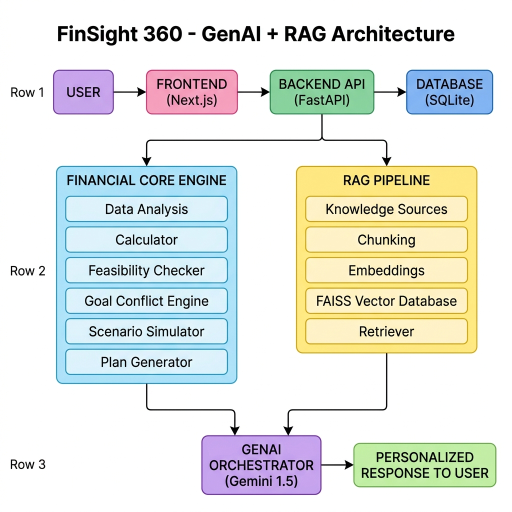

# FinSight 360 - Full Stack Personal Finance Advisor (Monorepo)

FinSight 360 is a full-stack, data-persistent, math-grounded personal finance planning application. It combines:
1. **Next.js React Frontend** with interactive dashboards, goal conflict visualization, and stress test what-if scenarios.
2. **FastAPI Python Backend** with:
   - **SQLite Database** to persist user credentials, settings, and custom goals.
   - **Finance Core Engine** which computes prioritization-weighted compounding and timeline delays programmatically.
   - **RAG Semantic Search Retrieval** querying official SEBI and RBI regulatory booklets.
   - **GenAI Layer** (Gemini 3.5 Flash) orchestrating tone adaptation and applying numerical guardrails to verify advice figures.

---

## System Architecture



---

## Directory Structure
```
finsight360/
├── backend/                  # FastAPI python backend
│   ├── app/
│   │   ├── core/             # Math logic & SIP calculator engine
│   │   ├── database/         # SQLite schema & persistence helpers
│   │   ├── genai/            # LLM narrative orchestration & guardrails
│   │   ├── rag/              # FAISS semantic vector search retriever
│   │   └── main.py           # Web router and endpoints
│   ├── requirements.txt      # Python dependencies
│   └── .env.example          # Environment variables template
├── frontend/                 # Next.js React frontend
│   ├── src/
│   │   ├── app/              # Dashboard pages & views
│   │   ├── components/       # Chat widgets & charts
│   │   └── lib/              # Local fallbacks & mock calculators
│   ├── package.json          # Node dependencies
│   └── .env.local.example    # SMTP settings template
├── .gitignore                # Global git ignore filters
└── README.md                 # Main setup manual
```

---

## Getting Started

### 1. Setup Backend
1. Go to the `backend` directory:
   ```bash
   cd backend
   ```
2. Install Python dependencies:
   ```bash
   pip install -r requirements.txt
   ```
3. Copy `.env.example` to `.env` and set your Gemini API key:
   ```bash
   copy .env.example .env
   ```
4. Start the FastAPI server:
   ```bash
   uvicorn app.main:app --reload --port 8000
   ```

---

### 2. Setup Frontend
1. Go to the `frontend` directory:
   ```bash
   cd ../frontend
   ```
2. Install Node dependencies:
   ```bash
   npm install
   ```
3. Copy `.env.local.example` to `.env.local` and set your SMTP settings:
   ```bash
   copy .env.local.example .env.local
   ```
4. Start Next.js development server:
   ```bash
   npm run dev
   ```

Open `http://localhost:3000` in your web browser. You can now register an account, log in, configure your profile/goals, and query the certified chatbot advisor!
