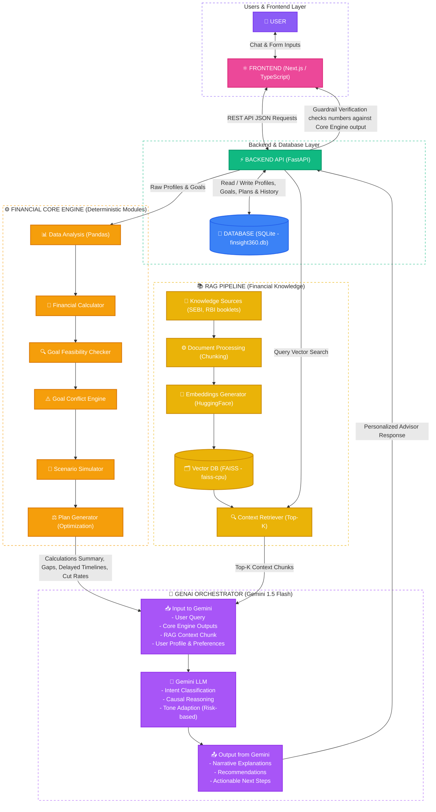

# FinSight 360 - System Architecture Diagram

This diagram represents the actual system architecture of your **FinSight 360** application (Next.js frontend, FastAPI backend, SQLite database, FAISS vector search, and Gemini GenAI orchestrator).

---

## 3. Legend & Flow Explanation

*   **Pink Layer (Frontend)**: Next.js React interface replacing the initial Streamlit framework. It handles user inputs (Forms, Charts, stress sliders) and renders markdown response blocks.
*   **Green Layer (Backend)**: FastAPI server orchestrating database CRUD, triggering vector searches, and running numerical checks.
*   **Blue Database**: SQLite backend storage (`finsight360.db`) replacing PostgreSQL, storing session data locally.
*   **Orange Engine (Finance Core)**: Python mathematical pipeline using pandas to check goal feasibility, conflict severity, and compute Tri-Plan variations.
*   **Yellow Engine (RAG Pipeline)**: Local document ingestion (RBI emergency funds, SEBI guidelines) stored inside a `FAISS` index.
*   **Purple Engine (GenAI Orchestration)**: The Gemini 1.5 Flash model acting as the system brain, digesting retrieved context + core math output to write guardrailed explanations.
